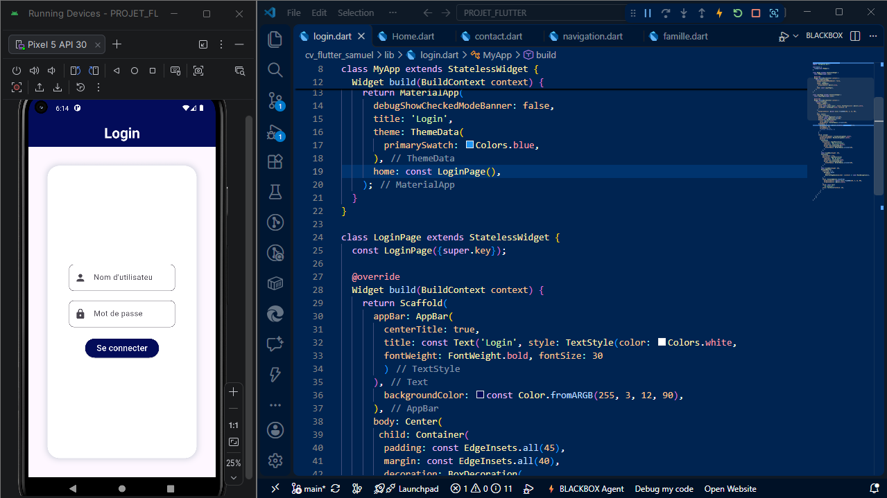
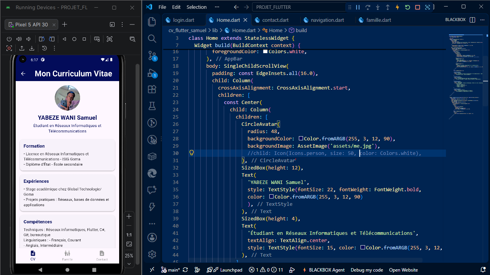
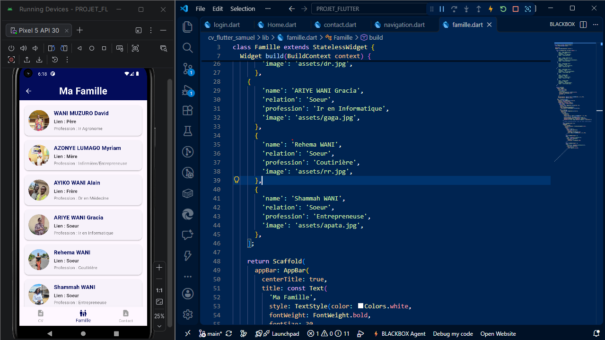
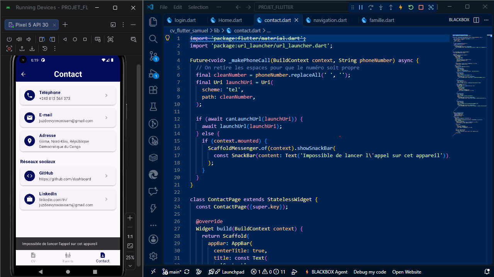
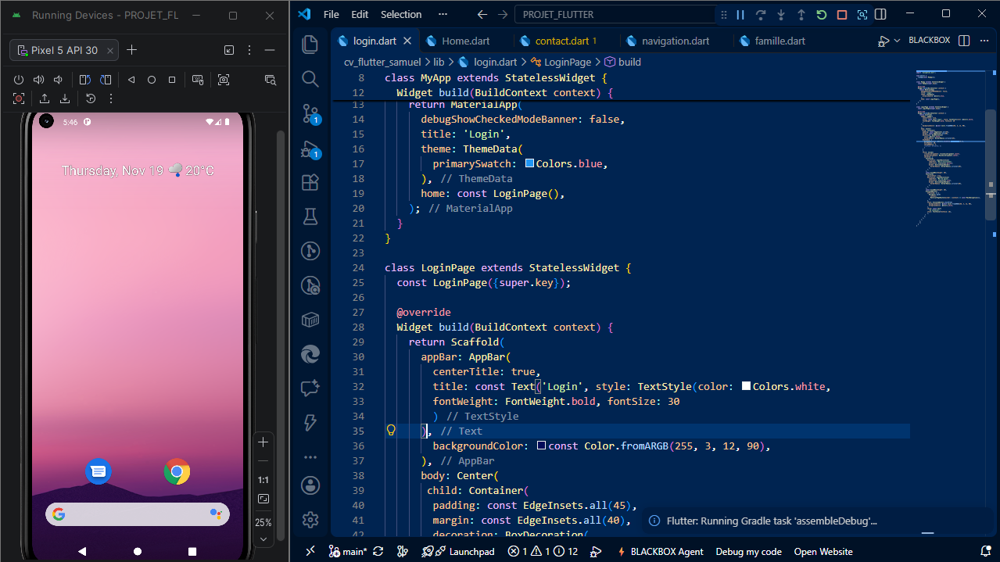

# cv_flutter_samuel

A new Flutter project.

## Getting Started

Application mobile Flutter présentant mon CV, ma famille et mes coordonnées, accessible après une page de connexion.

## Captures d'écran

### 1. Page de connexion

### 2. Page d'accueil (CV)

### 3. Page famille

### 4. Page contact

## Vidéo de démonstration

Regarder la démonstration complète du TP2 : [Voir la vidéo sur Google Drive]([https://drive.google.com/file/d/VOTRE_ID_FICHIER/view?usp=sharing](https://drive.google.com/file/d/1elSq46FZ0Mh9qFpO6BNCC90gAXV0aSUG/view))
This project is a starting point for a Flutter application.

A few resources to get you started if this is your first Flutter project:

- [Learn Flutter](https://docs.flutter.dev/get-started/learn-flutter)
- [Write your first Flutter app](https://docs.flutter.dev/get-started/codelab)
- [Flutter learning resources](https://docs.flutter.dev/reference/learning-resources)

For help getting started with Flutter development, view the
[online documentation](https://docs.flutter.dev/), which offers tutorials,
samples, guidance on mobile development, and a full API reference.
